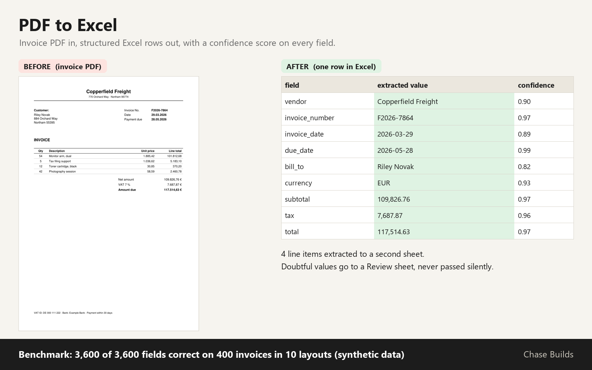

# pdf-to-excel

[](https://github.com/chasebuilds/pdf-to-excel/actions/workflows/ci.yml)  [](LICENSE)

Turns a folder of invoice PDFs into one Excel workbook, with a confidence score on every field and a review sheet that lists anything doubtful and why.



No per-vendor templates. No cloud service. The PDFs never leave the machine.

## Measured result

The numbers below are written into this file by the benchmark script from a real run on synthetic invoices. Full tables, method and caveats: [BENCHMARK.md](BENCHMARK.md).

<!-- benchmark:start -->
| Set | Invoices | Header fields correct | Wrong values passed as confident | Wrong values caught by review |
|---|---|---|---|---|
| Standard layouts (10) | 400 | 100.0% (3600/3600) | 0.0% (0/3600) | no wrong values |
| of which tuning layouts | 320 | 100.0% (2880/2880) | 0.0% (0/2880) | no wrong values |
| of which held-out layouts | 80 | 100.0% (720/720) | 0.0% (0/720) | no wrong values |
| Stress layouts (built to be hard, never tuned on) | 120 | 72.7% (785/1080) | 1.3% (14/1080) | 95.3% (281/295) |

**Confident-but-wrong rate: 0.0% (0/3600) of header fields on the standard layouts, 1.3% (14/1080) on the stress layouts.** This is the number that matters most: a wrong value that was not sent to the Review sheet.
<!-- benchmark:end -->

How to read it: the standard layouts are ordinary, clean invoices in ten different designs, two of which the extractor never saw during development. The stress layouts were built to break it. On those it gets a lot wrong, which is expected. What matters is the last column: when it was wrong, the value went to the review sheet instead of being passed off as fine.

## Before and after

Before: text on a PDF (`samples/invoices/02_euro_comma_decimals.pdf`), with day-first dates and comma decimals.

```
Copperfield Freight
Customer:                Invoice No.   F2026-7864
Riley Novak              Date          29.03.2026
                         Payment due   28.05.2026
Qty  Description             Unit price   Line total
54   Monitor arm, dual         1.885,42   101.812,68
...
Net amount     109.826,76 €
VAT 7 %          7.687,87 €
Amount due     117.514,63 €
```

After: one row in the `Invoices` sheet of `samples/invoices.xlsx`, typed as real dates and numbers.

| vendor | invoice_number | invoice_date | due_date | bill_to | currency | subtotal | tax | total | status |
|---|---|---|---|---|---|---|---|---|---|
| Copperfield Freight | F2026-7864 | 2026-03-29 | 2026-05-28 | Riley Novak | EUR | 109826.76 | 7687.87 | 117514.63 | OK |

And when something is off, a row in the `Review` sheet. Sample 08 is an invoice whose printed total is 100.00 too high:

| file | field | extracted_value | confidence | reason |
|---|---|---|---|---|
| 08_total_does_not_add_up.pdf | total | 134447.66 | 0.582 | subtotal + tax does not equal total (127950.15 + 6397.51 vs 134447.66) |

## Quick start

```
python -m venv .venv
.venv\Scripts\python -m pip install -e ".[dev]"
.venv\Scripts\pdf-to-excel samples/invoices -o samples/invoices.xlsx
```

On macOS or Linux use `.venv/bin/` in place of `.venv\Scripts\`. Needs Python 3.11 or newer.

That last command reads the nine sample PDFs and writes the sample workbook. Other commands:

```
pdf-to-excel my_invoices/ -o out.xlsx --threshold 0.9     # stricter: more goes to review
pdf-to-excel my_invoices/ -o out.xlsx --json out.json     # also write raw results
pdf-to-excel my_invoices/ -o out.xlsx --audit-sample 10   # spot check 10 passed invoices
python -m pytest                                          # tests, all offline
python -m pytest --cov                                    # tests with a coverage report
python -m mypy                                            # type check src/ (settings in pyproject.toml)
python -m benchmark.run_benchmark                         # regenerate data, rewrite BENCHMARK.md
```

As a library:

```python
from pdf_to_excel import extract_folder, write_workbook

results = extract_folder("my_invoices")
write_workbook(results, "out.xlsx", threshold=0.8)
print(results[0].get("total").value, results[0].get("total").confidence)
```

## Run as a service

The same extractor behind a small HTTP API (FastAPI). One PDF per request.

```
.venv\Scripts\python -m pip install -e ".[api]"
.venv\Scripts\uvicorn pdf_to_excel.api:app --port 8000
```

Or in Docker (slim Python image, runs as a non-root user):

```
docker build -t pdf-to-excel .
docker run --rm -p 8000:8000 pdf-to-excel
```

Then:

```
curl localhost:8000/health
curl -F "file=@samples/invoices/08_total_does_not_add_up.pdf" localhost:8000/extract
curl -F "file=@samples/invoices/01_classic_us.pdf" "localhost:8000/extract.xlsx?threshold=0.9" -o out.xlsx
```

| Endpoint | Returns |
|---|---|
| `GET /health` | `{"status": "ok", "version": "0.1.0"}` |
| `POST /extract` | JSON: status, every field with its value, confidence, page and reasons, the line items, the review list (the Review sheet rows) and the checks that ran |
| `POST /extract.xlsx` | The same four-sheet workbook the CLI writes, for that one PDF |

`threshold` (0 to 1, default 0.80) works the same as `--threshold`. A file that is not a PDF, an image-only scan (`NEEDS OCR`), or a PDF that cannot be read gets a 422 with the status and the reason. Uploads over 20 MB get a 413. Interactive docs are at `/docs` while the server runs.

Sample 08 returns, in part:

```
"status": "REVIEW",
"total": {"value": "134447.66", "confidence": 0.582, "page": 1,
          "reasons": ["subtotal + tax does not equal total (127950.15 + 6397.51 vs 134447.66)"]}
```

## How it works

Everything is deterministic Python on top of `pdfplumber`. No model is involved unless you switch one on.

1. **Read.** Each page becomes words with positions and font sizes. Words are grouped into lines by baseline and into cells by the gaps between them.
2. **Find labels.** A list of label wordings with a strength each: "Invoice Number" is strong, a bare "Reference" is weak. The longest wording wins, so "Due Date" is never read as "Date". Labels such as "PO Number", "Order Date" and "Tax ID" are recognised only so their values are not taken for something else.
3. **Find the value.** To the right of the label, or underneath it for stacked layouts. The value has to parse as the right kind of thing: a date, an amount, an invoice number.
4. **Dates and amounts.** Handles `03/25/2026`, `25.03.2026`, `2026-03-25`, `25 March 2026`, `Mar 25, 2026`, `25-Mar-2026`, and `1,234.56`, `1.234,56`, `1 234,56`, `1'234.56` with symbols or codes on either side. For `03/04/2026` it looks for evidence of which number is the month (another date on the page, the gap between invoice and due date). With no evidence it says so and flags the field.
5. **Line items.** Finds the header row by its wording, learns the column positions from the rows themselves, follows the table across pages and joins wrapped descriptions. With no recognisable header it falls back to rows where quantity x price = amount.
6. **Check the arithmetic.** Each line: quantity x unit price = amount. All lines: sum = subtotal. Totals: subtotal + tax (+ shipping, minus discount) = total. Tax = subtotal x the printed rate, when a rate is printed. A pass raises confidence. A fail lowers it and the review sheet names the check that failed, with the numbers.
7. **Check plausibility.** Due date not before invoice date, invoice date not in the future or over ten years old, total not zero, and across the batch, the same invoice number twice from one vendor (a likely duplicate).
8. **Score.** Confidence comes from real signals: how strong the label was, where the value sat, whether it parsed cleanly, whether a second method agreed, whether the checks held. Anything under the threshold (default 0.80) is highlighted yellow and listed for review.

The confidence number is a ranking score, not a probability. What a score is worth is shown by measurement in [BENCHMARK.md](BENCHMARK.md) under "What a confidence score means here": the share of values that were right in each band. Raise `--threshold` for a stricter batch.

Files that cannot be read as an invoice are never guessed at. Each gets a plain status and one line in the review sheet:

| Status | Meaning |
|---|---|
| `NEEDS OCR` | Scanned image, no text layer. |
| `BAD TEXT LAYER` | Text is present but is garbage (broken font encoding, bad hidden OCR). |
| `ENCRYPTED` | Password-protected. |
| `NO TEXT`, `EMPTY` | Blank pages, or no pages. |
| `ERROR` | Not a readable PDF. The batch carries on. |

### Tilted pages

A phone scanner app or a scanner's OCR step often saves the text layer a degree or a few off. Read as it is, the words break up into single letters and almost nothing comes back. The reader measures the tilt from the text itself (the step between neighbouring letters), and if it is between 0.3 and 15 degrees it turns the text back straight before reading. The Review sheet gets a file note saying the page was straightened and by how much.

Measured on `samples/skewed/`, copies of `samples/invoices/01_classic_us.pdf` made by `python -m benchmark.skew` (9 header fields, 10 line items):

| File | Fields right, deskew off | Fields right, deskew on | Mean confidence off / on | Line items off / on |
|---|---|---|---|---|
| straight original | 9/9 | 9/9 | 0.95 / 0.95 | 10 / 10 |
| tilted 1.5 degrees | 0/9 | 9/9 | 0.10 / 0.95 | 0 / 10 |
| tilted 3 degrees | 1/9 | 9/9 | 0.18 / 0.95 | 0 / 10 |
| tilted 5 degrees | 1/9 | 9/9 | 0.18 / 0.95 | 0 / 10 |
| blurred phone scan, 3 degrees, text layer underneath | 1/9 | 9/9 | 0.18 / 0.95 | 0 / 10 |

With deskew on, every field is right and above the threshold, the same as the straight copy. This needs a text layer: a tilted photo with no text layer is still `NEEDS OCR`.

### Optional: a second opinion from a local model

Off by default, and not used for any number in the benchmark. With `--llm-model <name>` the tool asks a model running in [Ollama](https://ollama.com) on the same machine about fields that are already under the threshold. Nothing is sent anywhere else: the code refuses any address that is not localhost. A model answer never clears a field from review by itself. It fills a blank at confidence 0.5 (still flagged, marked as a model suggestion), or adds a little confidence when it agrees with what the code already found. A suggested value that is not printed on the page is refused, so the model cannot invent one.

```
pdf-to-excel my_invoices/ -o out.xlsx --llm-model gemma4:e4b-it-qat
```

## What a client receives

One `.xlsx` file with four sheets:

- **Invoices**: one row per PDF. Vendor, invoice number, invoice date, due date, bill-to, currency, subtotal, tax, total, line count, page count, a status (`OK`, `REVIEW`, `NEEDS OCR`, `ERROR`) and a confidence column for every field. Doubtful cells are yellow.
- **LineItems**: one row per line. Description, quantity, unit price, amount, confidence, source page.
- **Review**: every field under the threshold, with the value that was extracted, the reason, and the source file and page. This is the to-do list. It also holds an **audit sample**: a few invoices that passed everything, picked at random, to spot check against the PDFs. That is how you find out for your own documents whether the unflagged rows can be trusted.
- **Summary**: counts, totals per currency, every check that was run on every invoice with pass or fail, a line to record what the audit sample found, and a file list with each PDF's SHA-256 so the run can be tied to the exact files.

Plus the benchmark report, so the accuracy claim can be checked and rerun.

## Limits

Short version, full list in [LIMITATIONS.md](LIMITATIONS.md):

- Tested on synthetic invoices only. Real documents from a new vendor will be harder than the standard layouts.
- No OCR. Scans with no text layer are reported, not read. Tilted pages that do have a text layer are straightened and read.
- English label wording. Unknown wording gives a blank, flagged field, not a guess.
- The seller's name is rarely labelled on an invoice. It is the weakest field, and the one place the stress test produced confident wrong answers.
- Confidence scores are weights chosen by hand, not calibrated probabilities.

## License

MIT. See [LICENSE](LICENSE).
